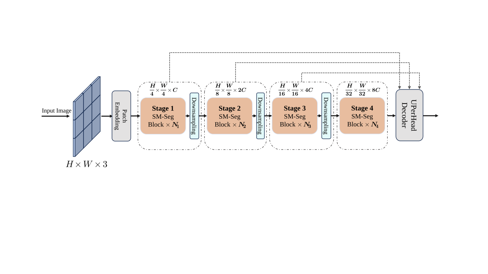
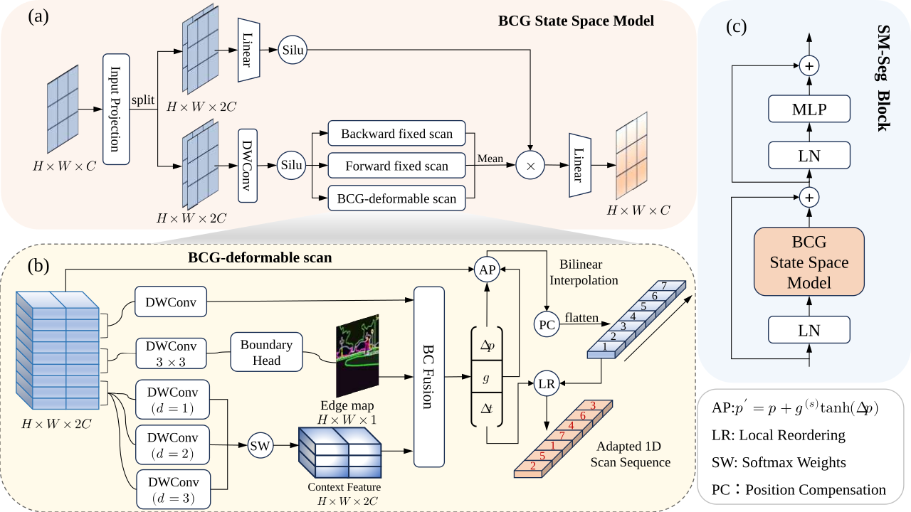
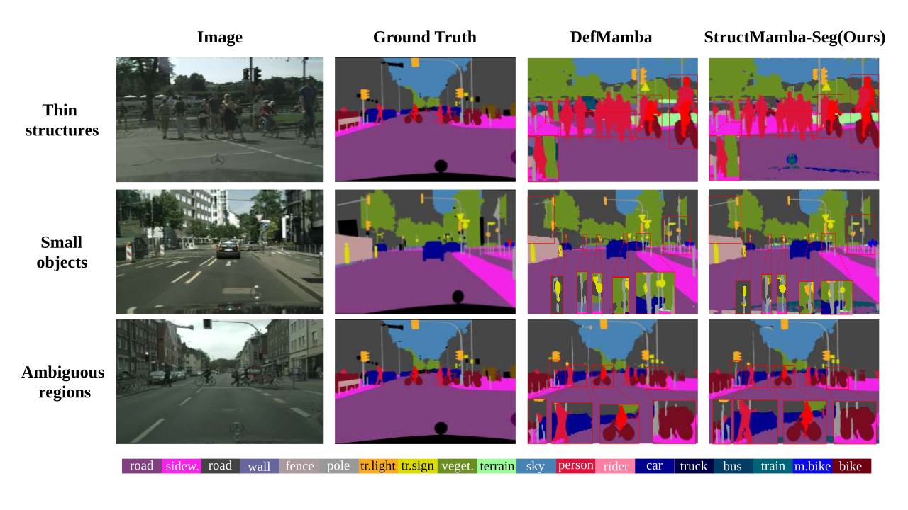

<div align="center">
<h1>StructMamba-Seg</h1>
<h3>StructMamba-Seg: Boundary-Context Guided Deformable Scanning for Semantic Segmentation</h3>
Paper: <a href="<ARXIV_LINK>">ArXiv</a> &nbsp;|&nbsp; Code: <a href="<GITHUB_REPO_LINK>">GitHub</a>
</div>

## Abstract

Scan-based visual state space models, especially Mamba-based methods, have shown strong potential for semantic segmentation by modeling long-range dependencies with high computational efficiency. These methods typically transform 2D feature maps into 1D scan sequences, where the sampling positions and scan orders directly affect the preservation of boundary and local structural information during recursive propagation. However, existing scan and offset modeling strategies are mostly designed for general visual representation learning, making them less effective at performing structure-sensitive decisions in boundary neighborhoods, locally deformed regions, and multi-scale semantic ambiguity areas. To address this issue, we propose **StructMamba-Seg** (**Structure-Sensitive Mamba for Semantic Segmentation**). Specifically, we introduce a **Boundary-Context Guided Deformable Scan (BCG-DefScan)** into the Mamba scanning backbone, and construct an offset prediction network jointly driven by boundary cues and multi-scale contextual information. This design enables structure-sensitive scan decisions for segmentation scenarios, thereby adaptively regulating feature sampling positions, local organization, and offset effect strength. During training, we further introduce **IoU-Boundary Joint Optimization** to complement the main scanning mechanism with additional supervision on region quality and boundary details. Experiments show that StructMamba-Seg achieves consistent improvements on benchmarks such as **Cityscapes** and **ADE20K**, while exhibiting stronger structure preservation and category separation ability in small objects, thin structures, and semantically ambiguous regions.

## Overview

- Overall Framework
<p align="center">
  
</p>

- BCG State Space Model
<p align="center">
  
</p>

- Qualitative Comparison
<p align="center">
  
</p>

## Main Results

### **Semantic Segmentation on ADE20K**

| Model | Input | #Params | FLOPs | Segmentor | mIoU(SS) | mIoU(MS) |
|:-----:|:-----:|:-------:|:-----:|:---------:|:--------:|:--------:|
| StructMamba-Seg | 512×512 | 68.2M | 483G | UPerNet@160k | 50.2 | 51.1 |

### **Semantic Segmentation on Cityscapes**

| Model | Train Crop | Eval Resolution | #Params | FLOPs | Segmentor | mIoU |
|:-----:|:----------:|:---------------:|:-------:|:-----:|:---------:|:----:|
| StructMamba-Seg | 512×1024 | 2048×1024 | 68.2M | 1920G | UPerNet@120k | 82.12 |

### **Semantic Segmentation on Pascal Context**

| Model | Input | Segmentor | Setting |
|:-----:|:-----:|:---------:|:-------:|
| StructMamba-Seg | 512×512 | UPerNet@80k | 59-class |

> Pascal Context support is included in the public release. Final reported numbers and released checkpoints can be updated after the paper and model release are finalized.

## Supported Scope

The **paper experiments** reported in StructMamba-Seg are conducted on the following three benchmarks only:

- **Cityscapes**
- **ADE20K**
- **Pascal Context**

At the **repository level**, the public codebase currently includes dataset configs, base dataset definitions, or tool support for the following segmentation datasets:

- **ADE20K**
- **BDD100K**
- **CHASE DB1**
- **Cityscapes**
- **COCO-Stuff10K**
- **COCO-Stuff164K**
- **DRIVE**
- **HRF**
- **iSAID**
- **LEVIR-CD**
- **LoveDA**
- **Mapillary Vistas v1.0**
- **Mapillary Vistas v1.65**
- **Mapillary Vistas v2.0**
- **NYU**
- **Pascal Context**
- **Pascal VOC 2012**
- **Potsdam**
- **REFUGE**
- **STARE**
- **Synapse**
- **Vaihingen**

In addition, the repository also includes multiple dataset-specific variants for some benchmarks, such as different input-resolution settings for **Cityscapes**, **ADE20K**, **NYU**, and **LEVIR-CD**.

Please note that **repository-level support does not mean that all supported datasets are included in the paper’s main experimental tables**. The official results reported in the paper are restricted to **Cityscapes, ADE20K, and Pascal Context**, while the remaining datasets are included as extended configuration and tooling support in the public release.


## Getting Started

### Installation

**Step 1: Clone the StructMamba-Seg repository**

```bash
git clone <GITHUB_REPO_LINK>
cd StructMamba-Seg
```

**Step 2: Environment Setup**

***Create and activate a new conda environment***

```bash
conda env create -f environment.yaml
conda activate structmamba_seg
```

Or manually:

```bash
conda create -n structmamba_seg python=3.10
conda activate structmamba_seg
```

***Install PyTorch***

```bash
pip install torch==2.4.1 torchvision==0.19.1 torchaudio==2.4.1 --index-url https://download.pytorch.org/whl/cu121
```

***Install Dependencies***

```bash
pip install -r requirements.txt
cd kernels/selective_scan && pip install .
cd ../..
```

***Dependencies for Semantic Segmentation***

```bash
pip install mmengine==0.10.1 mmcv==2.1.0 opencv-python-headless ftfy regex
pip install mmsegmentation==1.2.2
```

## Quick Start

### Training

To train StructMamba-Seg on the paper benchmarks:

**Cityscapes**
```bash
bash scripts/train_cityscapes.sh
```

**ADE20K**
```bash
bash scripts/train_ade20k.sh
```

**Pascal Context**
```bash
bash scripts/train_pascal_context.sh
```

### Evaluation

**Cityscapes (single-scale)**
```bash
bash scripts/test_cityscapes.sh
```

**Cityscapes (TTA / full-resolution evaluation)**
```bash
bash scripts/test_cityscapes_tta.sh
```

**Boundary Evaluation**
```bash
bash scripts/eval_boundary.sh
```

**Hard-class / Small-class Evaluation**
```bash
bash scripts/eval_hard_small.sh
```

### FLOPs and Params

**Cityscapes**
```bash
bash scripts/get_flops.sh cityscapes
```

**ADE20K**
```bash
bash scripts/get_flops.sh ade20k
```

**Pascal Context**
```bash
bash scripts/get_flops.sh pascal_context
```

## Dataset Preparation

Please prepare the datasets before training or testing.

Detailed instructions are provided in:

- `docs/DATA_PREPARATION.md`

The officially documented paper benchmarks are:

- Cityscapes
- ADE20K
- Pascal Context

## Project Structure

```text
StructMamba-Seg/
├── assets/
├── checkpoints/
├── core/
├── docs/
├── kernels/
├── scripts/
├── segmentation/
├── tools/
├── .gitignore
├── environment.yaml
├── LICENSE
├── NOTICE
├── README.md
└── requirements.txt
```

## Checkpoints

Released checkpoints should be placed under:

```text
checkpoints/
```

Recommended filenames:

- `structmamba_seg_cityscapes_120k.pth`
- `structmamba_seg_ade20k_160k.pth`
- `structmamba_seg_pascal_context_80k.pth`
- `defm_small.pth`

Please see `checkpoints/README.md` and `docs/MODEL_ZOO.md` for more details.

## Citation

If StructMamba-Seg is helpful for your research, please cite the following paper:

```bibtex
@article{<CITATION_KEY>,
  title   = {StructMamba-Seg: Boundary-Context Guided Deformable Scanning for Semantic Segmentation},
  author  = {<AUTHORS>},
  journal = {arXiv preprint arXiv:<ARXIV_ID>},
  year    = {<YEAR>}
}
```

## Acknowledgment

This project is built upon the broader open-source ecosystem of visual state space models and semantic segmentation toolchains. In particular, our implementation is developed on top of the **DefMamba / DeformableMamba** codebase and further extended for semantic segmentation. We sincerely acknowledge the following excellent works and repositories:

- DefMamba / DeformableMamba
- VMamba
- Mamba
- OpenMMLab / MMSegmentation
- Swin Transformer
- ConvNeXt
- related visual Mamba / SSM baselines

We thank the authors and contributors of these projects for making their code and research publicly available.